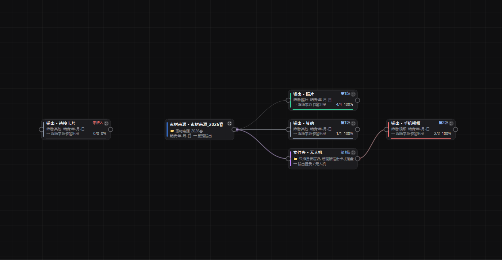

# MediaOrganizer · 素材整理工作流

[](LICENSE)
[](https://www.python.org/)
[](#requirements)

**English** · [中文说明](#中文说明)

A portable Windows app that organizes messy photo/video material by **category + date**, where the
organizing work itself is a visual **card-chain workflow** — the chain you draw on the canvas *is* the
output folder hierarchy.



### Features

- **Card chain = directory hierarchy.** `source card → (folder card) → output card`; the further a card
  is from the source, the deeper the folder it produces.
- **Auto-complete the three standard categories** — adding a source card automatically creates and wires
  the *Photos / Videos / Other* output cards.
- **Folder cards are pure directory levels.** You just type a name; they filter nothing and never write files.
- **Output cards do the work** — they filter (Photos / Videos / Other / custom extensions) and archive.
- **Custom-extension output cards claim their extensions exclusively**, so one file is never copied twice.
- **Date-based archiving** — `year` / `year-month` / `yyyy-mm-dd`; EXIF capture time is preferred for photos.
- **Concurrency** — up to 3 transfers in parallel, large videos limited to 1; per-file progress,
  prioritize / pause / abort.
- **Portable** — no installer, no registry writes; settings live in `MediaOrganizer.ini` next to the exe.
- **Diagnostics** — `startup.log` plus a global exception hook (this fixes the silent `0xC0000409`
  deaths that PyQt6 causes when an exception escapes a Qt callback).

### Quick start

1. Download the portable build from [Releases](../../releases) — unzip the whole folder
   (`_internal/` is the runtime, don't copy the exe alone) and run `MediaOrganizer.exe`.
2. **➕ Add source** → pick the material folder, then the output root folder.
   The three category cards are created and wired for you.
3. *(optional)* **📁 Add folder card**, type a folder name, and hang an output card under it —
   e.g. `output/Drone/Video/2026-03-27/clip.mp4`.
4. **▶ Run**.

Run from source:

```powershell
py -m pip install PyQt6 pillow
py media_organizer.py            # card-chain editor (default)
py media_organizer.py --classic  # legacy "pick two folders" UI
```

### Build

```powershell
py -m pip install pyinstaller
.\build.ps1     # -> release\MediaOrganizer\  and  release\MediaOrganizer_v1.0.zip
```

### Tests

```powershell
py media_organizer.py --selftest      # classification/date logic, exit code 0
py tests\wf_test.py                   # scheduler end-to-end   -> _wf_result.txt
py tests\editor_test.py               # 13 GUI checks          -> _editor_result.txt
py media_organizer.py --smoke-leave   # crash regression       -> _smoke_result.txt
```

### Requirements

Windows 10/11 · Python 3.12 (when running from source) · PyQt6 6.11 · Pillow ·
PyInstaller 6.22 (`onedir`).

### License

[MIT](LICENSE). Issues and pull requests are welcome — English or 中文 both fine.

---

## 中文说明

Windows 便携式（免安装）照片 / 视频素材整理工具：把乱七八糟的素材按**类别 + 日期**归档，
整理过程做成一条可视化的**卡片链工作流** —— 卡片连线既是数据流，也直接决定输出目录的层级。

用 Python 3.12 + PyQt6(Qt 6.11) 写成，PyInstaller 打包成单文件夹 exe，拷走即用。

---

## 特性

- **卡片链 = 目录层级**：来源卡 →（文件夹卡）→ 输出卡，链上越深的卡就是输出目录里越深的一层
- **三类自动补全**：添加来源卡时自动建好并连好 照片 / 视频 / 其他 三张末端输出卡
- **文件夹卡（纯目录层级）**：只填一个文件夹名，不筛选、不落盘 —— 相当于在两层之间夹一层目录，
  名字就是你填的那个
- **自定义后缀**：输出卡可填多个后缀（如 `.dng, .arw`），这类卡**独占**该后缀，
  照片 / 视频 / 其他 不会重复收，避免同一个文件拷两份
- **日期归档**：按 年 / 年-月 / 年-月-日 分目录；照片优先读 EXIF 拍摄时间，其余取修改时间
- **多路并发**：最多 3 路同时传输，视频大文件单独限 1 路；支持右键加急、暂停、中断
- **每文件进度**：连线上的光点沿链路流动（整条链一起亮），卡片显示 `已完成/总数`
- **交互细节**：拖动卡片连线实时跟随、鼠标靠近连线浮出 ✕ 可删、任意接线柱互接、
  成环拒绝、接线方向按"离源远近"自动判定
- **便携**：无安装、不写注册表，配置存在程序旁的 `MediaOrganizer.ini`

---

## 快速开始

### 用便携版（推荐给最终用户）

1. 解压出 `MediaOrganizer` 整个文件夹（**不要只拷 exe**，`_internal` 目录是运行时依赖）
2. 双击 `MediaOrganizer.exe`
3. 右侧【➕ 添加来源卡】选素材文件夹、再选输出根目录 → 自动生成三类输出卡 → 点【▶ 运行工作流】

详细操作见 [`使用说明.txt`](使用说明.txt)。

### 跑源码

```powershell
py -m pip install PyQt6 pillow
py media_organizer.py            # 默认打开多卡片工作流编辑器
py media_organizer.py --classic  # 旧版界面: 固定三类 + 选两个文件夹就能跑
```

---

## 命令行参数

| 参数 | 作用 |
|---|---|
| （无） | 打开多卡片工作流编辑器 |
| `--classic` | 打开旧版"数据光带工作流"界面 |
| `--selftest` | 无界面跑分类/日期逻辑自检，退出码 0 = 通过 |
| `--smoke-leave` | 闪退回归自检：自动发 Leave 事件 + 在 Qt 回调里故意抛异常，结果写 `_smoke_result.txt` |
| `--smoke` | 打开窗口 4 秒后自动退出（打包冒烟） |
| `--demo` | 造一批 demo 素材并把工作流跑一遍（配合 `--shot` 出图） |
| `--shot <png>` | 启动后截图退出（自动强制软件渲染，见下） |

---

## 卡片链模型

```
来源卡(根)                 ← 添加时选"输出根目录"
  ├── 照片卡(输出)          → 输出根/照片/<日期>/xxx.jpg        (第1级)
  ├── 其他卡(输出)          → 输出根/其他/<日期>/xxx.txt        (第1级)
  └── 文件夹卡 "无人机"     → 只作一层目录, 自己不收文件        (第1级)
        └── 视频卡(输出)    → 输出根/无人机/视频/<日期>/xxx.mp4 (第2级)
```

三种卡各司其职：

| 卡 | 作用 | 会落盘吗 |
|---|---|---|
| 来源卡 | 链路根：素材文件夹 + 输出根目录；只有【出】接线柱 | 否 |
| 文件夹卡 | **纯目录层级**：只有一个名字，不筛选、不落盘 | 否（即使接在末端，日志会提示"后面还没接输出卡"） |
| 输出卡 | 筛选（照片/视频/其他/自定义后缀）+ 落盘 | 是（且只有它作为链路末端时） |

规则：

- **级数只看"离来源多远"**：来源 = 0，直接接在来源上 = 1，再下一级 = 2…
  卡片右上角直接显示 `第N级` / `未接入`；一键整理把同级卡排在**同一列**。
- **只有末端输出卡落盘**，中间的卡（含文件夹卡）只贡献一层文件夹名（输出卡会标 `[文件夹]`）。
- **接线方向自动判定**：两张卡级数不同时，**离来源更近的那张作上一级**，你点哪根先都一样；
  只有两张卡**同级**时才按点击先后定（先点【出】的作上一级）。
- **【入】只能有一个上一级**，重接等于换上一级；**【出】可以多路分叉**；禁止成环。
- 某张卡可以单独指定输出位置，那时它以自己为新的根（默认跟随来源卡）。
- 未接入来源卡的卡片会被跳过（日志提示），不影响其余卡片运行。

> 想让某批后缀单独进一个目录：`源 → 文件夹卡(名字) → 输出卡(自定义后缀 .dng,.arw)`。
> 这类输出卡会**独占**这些后缀，照片/视频/其他三张卡自动让路，不会重复拷贝。

---

## 目录结构

```
MediaOrganizer/
├── media_organizer.py        主程序: 诊断基础设施 + 归档逻辑 + 旧版光带界面 + 入口
├── workflow_editor.py        多卡片工作流编辑器(默认入口), 依赖 media_organizer
├── MediaOrganizer.spec       PyInstaller 配置(onedir + 排除 numpy/yaml + 关闭 UPX)
├── media_organizer.ico       应用图标
├── 使用说明.txt               给最终用户的中文说明(会打进 release)
├── build.ps1                 一键打包成便携版 + zip
├── tests/wf_test.py          调度器端到端测试(3 任务并发, 校验不重复拷贝)
├── tests/editor_test.py      编辑器端到端自检(13 项: 接线定向/级数/同列/文件夹卡/独占/落盘路径)
├── tools/make_icon.py        重新生成图标
├── docs/                     README 用截图
└── release/                  build.ps1 的产物(便携版文件夹 + zip, 不入库)
```

---

## 构建

```powershell
.\build.ps1
# 产物: release\MediaOrganizer\  (exe + _internal + 使用说明.txt)
#       release\MediaOrganizer_v1.0.zip
```

等价的原始命令：

```powershell
py -m PyInstaller --noconfirm MediaOrganizer.spec
```

---

## 验收 / 测试

```powershell
py media_organizer.py --selftest                    # 归类逻辑, 退出码 0
py tests\wf_test.py                                 # 读 _wf_result.txt -> WF_RESULT: PASS
py tests\editor_test.py                             # 读 _editor_result.txt -> EDITOR_RESULT: PASS
py media_organizer.py --smoke-leave                 # 读 _smoke_result.txt -> [3/3] PASS
py media_organizer.py --classic --smoke-leave        # 旧版同样 PASS
py media_organizer.py --demo --shot out.png          # 出图, 画布必须有内容
release\MediaOrganizer\MediaOrganizer.exe --smoke-leave
```

> ⚠ PowerShell 会吞中文 stdout：**验证结果写文件再读**，别靠肉眼盯控制台。
> 退出码 `-1073740791` = `0xC0000409`，含义见下节。

---

## 设计说明与踩过的坑

这一节是给改代码的人看的，几条都是实测踩出来的：

1. **`0xC0000409` 不等于"栈溢出"**：PyQt6 对**从 Qt 回调里逃逸出来的 Python 异常**会调用
   `qFatal()` → UCRT `abort()` → `__fastfail`，进程静默消失（无对话框、无 Python 栈、
   `faulthandler` 也抓不到）。所以本程序装了 `install_excepthook()`（自定义 hook 且**不再抛出**），
   任何回调里的未捕获异常只落日志、进程继续跑。
2. **`QWidget.grab()` 抓不到 `QOpenGLWidget` 的内容**：GL 渲染时截出来的画布是纯白。
   所以 `--shot` 会强制走软件渲染；否则"出图即通过"的验收等于没验。
3. **GL 交不出画面时 `grabFramebuffer()` 返回全黑帧**：启动 150ms 后自检 `avg/spread`，
   异常就自动回退软件渲染（日志会记一行 `GPU 探测: ... -> 回退软件渲染`）。
   手工兜底：程序旁放空文件 `MediaOrganizer.raster` 或设环境变量 `MO_RASTER=1`。
4. **GL viewport 不能配局部刷新**：`QOpenGLWidget` 做 viewport 时若用
   `BoundingRectViewportUpdate`，移动卡片会留残影 —— Qt 文档明确要求这类 viewport 用
   `FullViewportUpdate`。代码里按 viewport 类型自动选。
5. **`itemChange()` 默认不触发**：要让"拖动卡片时连线跟着走"，必须给图元打开
   `ItemSendsGeometryChanges` 标志。
6. **改 `boundingRect()` 前必须 `prepareGeometryChange()`**：不然旧像素不会被作废，
   表现为拖动时满屏残影。
7. **中文输出在 PowerShell 里会被吞**：所有验证都写文件。

---

## 故障诊断

程序运行会在 exe 旁生成（源码运行时在项目目录）：

| 文件 | 内容 |
|---|---|
| `startup.log` | 启动/退出打点、GPU 探测结论、`QT[...]` 消息、`!! 未捕获异常(已拦截)` 及完整调用栈 |
| `_smoke_result.txt` | `--smoke-leave` 的分步结果，跑到 `[3/3] PASS` 才算通过 |
| `MediaOrganizer.ini` | 记住上次用的文件夹（便携配置，不写注册表） |
| `MediaOrganizer.raster` | **用户自建**的空文件：强制软件渲染（黑屏/花屏兜底） |

出问题时优先看 `startup.log` 最后几行；若系统弹过错误框，再附上
`eventvwr` → Windows 日志 → 应用程序 → MediaOrganizer 的"错误模块名称 + 异常代码"。

---

## 已知限制

- 只针对 **Windows**（用了 Qt 的 `windows` 平台插件、注册表无关但仍以 Windows 为唯一验证目标）
- 归档粒度到**日**为止；不做去重、不做人脸/内容识别
- 中断或关窗会丢失尚未拷完的部分（进度到 100% 才是完整落盘）
- 两张末端卡筛选完全相同时会各拷一份（日志会警告），需要人工避免重复配置

---

## 许可

[MIT](LICENSE)
